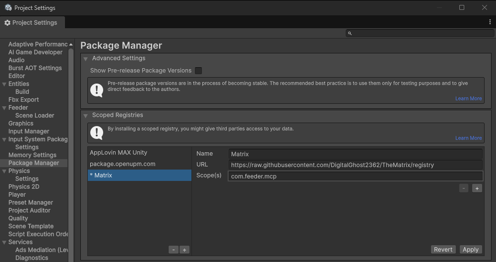
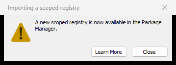
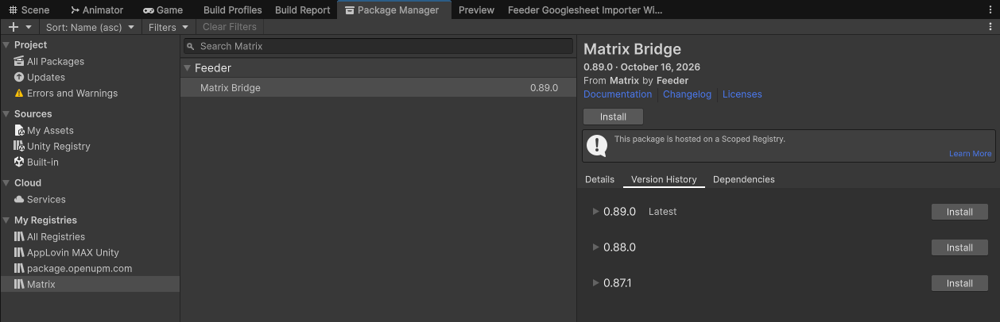
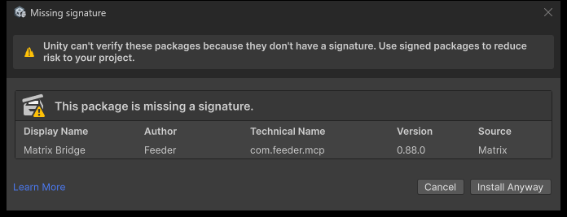
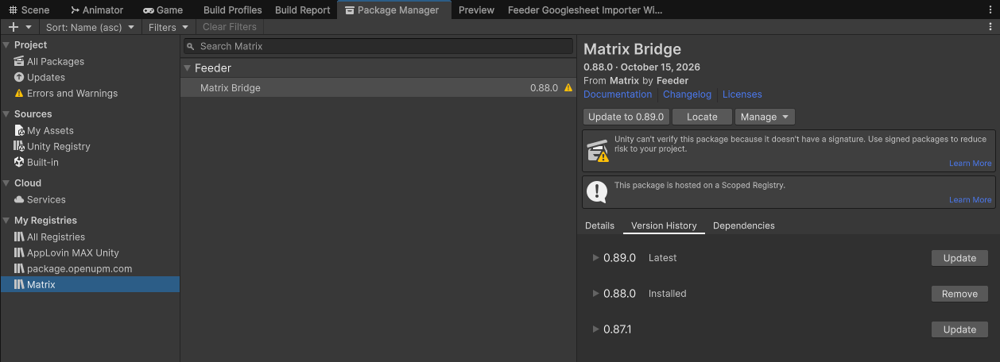

# TheMatrix

The standalone development repository for **Matrix Bridge**,
a Unity Editor package that bundles its local MCP server and can be installed independently
from FeederBase.

## Requirements

- Unity 2022.3 or newer
- Windows x64 for the currently bundled local server

## Install in another Unity project

Matrix Bridge is published to its own package registry. Package Manager then lists every release, and
you can move a project to any of them.

### 1. Add the Matrix registry (once per project)

Open **Edit > Project Settings > Package Manager**. Under **Scoped Registries**, click **+**, fill in
the fields and click **Apply**:

| Field | Value |
|---|---|
| Name | `Matrix` |
| URL | `https://raw.githubusercontent.com/DigitalGhost2362/TheMatrix/registry` |
| Scope(s) | `com.feeder.mcp` |



Unity confirms with **A new scoped registry is now available in the Package Manager**. Click **Close**.



### 2. Install Matrix Bridge

Open **Window > Package Manager**, select **My Registries > Matrix > Matrix Bridge** and click
**Install**.



The package has no signature, so Unity 6 asks before installing it. Click **Install Anyway**. When
Unity reports the same thing as the project opens, click **Close**. The yellow triangle next to the
version in the list is the same notice; it does not block anything.



### 3. Switch versions

Select **Matrix Bridge**, open **Version History** and click **See other versions**. Click **Update**
on the version you want. **Update to X.Y.Z** at the top installs the newest one.



After moving to an older version, restart Unity: the server of the newer version keeps running until
then.

### Install from the manifest instead

Add the same registry and the version you want to the project's `Packages/manifest.json`:

```json
{
  "scopedRegistries": [
    {
      "name": "Matrix",
      "url": "https://raw.githubusercontent.com/DigitalGhost2362/TheMatrix/registry",
      "scopes": ["com.feeder.mcp"]
    }
  ],
  "dependencies": {
    "com.feeder.mcp": "0.89.0"
  }
}
```

A project that installed the package from the Git URL moves to the registry by replacing that URL with
a version number, as above.

### Install from Git (no version list)

**Window > Package Manager > + > Add package from git URL** also works, with a tag for a fixed release:

```text
https://github.com/BingoBoiz/TheMatrix.git?path=/Packages/com.feeder.mcp#v0.89.0
```

This needs Git on the machine, and Package Manager shows only the installed version.

## Use

Open the project once after installing: the package auto-starts the local MCP server, writes
the project-root `.mcp.json` for Claude Code, and generates `.claude/skills`. No manual setup
is needed for Claude Code.

For other AI clients or to opt out of auto-configure, open
**Tools > Feeder > Bridge**.

## Repository layout

- `Packages/com.feeder.mcp`: the distributable UPM package
- `Assets`, `ProjectSettings`, and the remaining `Packages` files: the local development project
- `.github`: the workflow and script that publish the package registry

Projects that install Matrix Bridge receive only `Packages/com.feeder.mcp`.

## Release checklist

1. Set the new version in `Packages/com.feeder.mcp/package.json` and in `MatrixPlugin.Version`
   (`Packages/com.feeder.mcp/Runtime/MatrixPlugin.cs`).
2. Add the release notes to `Packages/com.feeder.mcp/CHANGELOG.md`.
3. Open this project in the minimum supported Unity version and verify there are no compile errors.
4. Commit, create an annotated tag `vX.Y.Z` that matches the version, and push both:
   `git push origin main --follow-tags`.
5. The **UPM registry** workflow packs the tag, attaches the tarball to a GitHub release and adds the
   version to the `registry` branch. Package Manager lists it a few minutes later.

## License

MIT. See [LICENSE](LICENSE).
